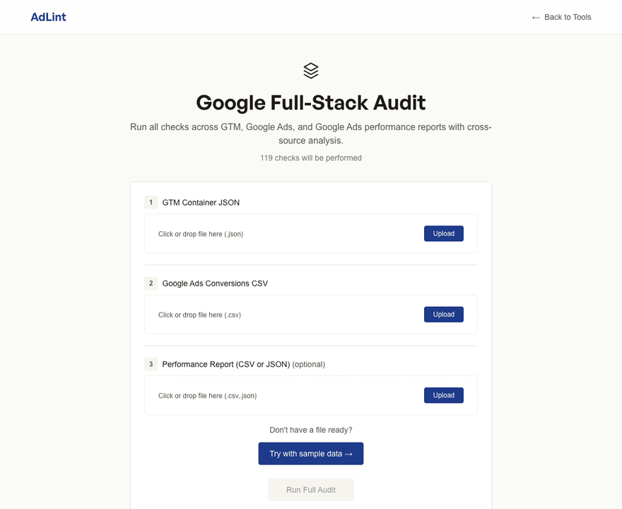

<p align="center">
  
</p>

<h1 align="center">AdLint</h1>

<p align="center">
  <strong>Broken conversion tracking doesn't announce itself. AdLint finds it in the exports you already have.</strong>
</p>

<p align="center">
  178 checks · Google Ads, Google Tag Manager and 6 pixel platforms · runs in your browser, files never uploaded
</p>

<p align="center">
  <a href="https://github.com/ChristopherLandaverde/adlinter/actions/workflows/ci.yml"></a>
  <a href="package.json"></a>
  <a href="LICENSE"></a>
</p>

<p align="center">
  <a href="https://adlinter.vercel.app">Live demo</a> · <a href="#try-it">Try it</a> · <a href="#what-it-checks">What it checks</a> · <a href="#known-limits">Known limits</a> · <a href="#privacy">Privacy</a>
</p>

A conversion counted twice halves your reported CPA overnight, and Smart Bidding starts spending against numbers that aren't real. An account with no primary conversion gives Smart Bidding no target, and a revenue conversion that fires without a value leaves value-based bidding blind. The ad platform shows none of these as an error: spend keeps going out and the dashboards keep filling. AdLint reads your GTM container, Google Ads conversion export, performance report or pixel export and tells you what is broken, how badly, and how to fix it.

<p align="center">
  
  <br><sub>Recorded on the <a href="https://adlinter.vercel.app">live demo</a> with the bundled Google Full-Stack sample, nothing uploaded: one click to a 73/100 score with 90 of 119 checks passing, the three most critical findings first, and each finding's explainer with why it matters and how to fix it.</sub>
</p>

## Who it's for

| You are | You come to |
|---|---|
| An agency or freelancer auditing ad tracking you didn't build | Hand the client a list of findings, each with a fix and a citation they can check |
| An in-house marketer who suspects the tracking is off | Get a second opinion before launch or when the numbers look wrong, without waiting on an engineer |

## What you get

- **Know which conversions are double-counted.** Duplicate conversion tags in GTM, duplicate conversion actions in Google Ads, duplicate event names in each pixel export.
- **Know whether bidding has a real target.** Missing primary conversion, a micro-conversion set as primary, too little conversion volume for Smart Bidding.
- **Know which Google Ads conversions no tag is sending.** Cross-checks the Google Ads export against the GTM container, including conversion ID and label matching.
- **Know where conversion value is missing or wrong.** Revenue conversions counting with no value, $0 purchases, configured value vs. reported value, purchase events without value on each pixel.
- **A finding you can defend.** One 0-100 Tracking Health Score, findings ranked critical / warning / info, and a `/checks/<id>` page per finding with why it matters, how to fix it, platform documentation and a citation paragraph for your client report.

## Try it

**No install:** open the [live demo](https://adlinter.vercel.app), pick a tool (for example **Google Full-Stack Audit**) and click **Try with sample data**. The bundled sample files load and you land on the audit results page shown above. Every tool has a sample.

**Run it locally** (Node 20, the version CI uses):

```bash
git clone https://github.com/ChristopherLandaverde/adlinter.git
cd adlinter
npm ci
npm run dev
```

Open <http://localhost:3000>, pick a tool and click **Try with sample data**, or upload your own export.

## What it checks

| Tool | Input | Checks (registry source) |
|---|---|---|
| GTM Container Auditor | GTM container export (`.json`) | 29 (`gtm`) |
| Google Ads Linter | Google Ads conversions export (`.csv`) | 34 (`ads`) |
| Google Ads Performance Report | Performance report (`.json`) | 26 (`report`) |
| Google Full-Stack Audit | All three Google files | the three above, plus 29 cross-source checks (`cross`) for consistency between them |
| Meta, TikTok, LinkedIn, Pinterest, Twitter/X, Snapchat auditors | Each platform's event or conversion export (`.csv` or `.json`) | 10 per platform |

Counts are the distinct check IDs in [`lib/checks/registry.generated.ts`](lib/checks/registry.generated.ts), which is regenerated from the check files on every build. Run `npm run gen:registry` to print the current total and the count per source. The live [`/checks`](https://adlinter.vercel.app/checks) index lists every check with its explainer page.

<details>
<summary>Example checks per source</summary>

| Source | Examples |
|---|---|
| GTM | Missing Conversion Linker, GDPR consent, preview/debug tags in production, mixed Data Layer versions, circular tag dependencies, trigger conflicts, unused triggers and variables |
| Google Ads | Duplicate conversion actions, no primary conversion, counting method vs category, attribution window analysis, value data for ROAS bidding, Smart Bidding volume |
| Performance report | ROAS sanity, ghost conversions, attribution drift, signal pollution, value concentration, whale check |
| Cross-source | Ads conversions missing GTM tags, conversion ID/label matching, settings vs report counts, configured vs actual value, currency consistency |
| Meta Pixel | Missing PageView, missing conversion events, duplicate or similar event names, purchase value tracking, e-commerce funnel events |
| TikTok Pixel | Base pixel active events, CompletePayment value tracking, duplicate or similar event names, zero-volume events |
| LinkedIn Insight Tag | No active conversions, missing key conversions, Other category overuse, short conversion windows, unattached conversions |
| Pinterest Tag | Missing PageVisit, Checkout value tracking, Conversion API parity, duplicate event names, tag configuration quality |
| Twitter/X Pixel | Missing `conversion_id`, deduplication, event ID format, Tweet engagements used instead of conversions |
| Snapchat Pixel | Pixel ID format, missing PAGE_VIEW, standard event names, CAPI deduplication and currency alignment |

</details>

<details>
<summary>How to get each export</summary>

**GTM container:** Google Tag Manager → **Admin** → **Export Container** → choose the latest version and save the `.json` file.

**Google Ads conversions:** Google Ads → **Tools** → **Conversions** → **Download** → CSV.

**Meta Pixel events:** Meta Events Manager → Diagnostics or Test Events. CSV or JSON.

**TikTok Pixel events:** TikTok Events Manager → Web Events → Export. CSV or JSON.

**LinkedIn conversion actions:** Campaign Manager → Account Assets → Conversions → Export. CSV or JSON.

**Pinterest Tag events:** Pinterest Ads Manager → Conversions. CSV or JSON.

**Twitter/X Pixel events:** Twitter/X Ads Manager → Events Manager. CSV or JSON.

**Snapchat Pixel events:** Snapchat Ads Manager → Events Manager. CSV or JSON.

</details>

## Features

- **Tracking Health Score:** one 0-100 number computed from weighted severity, with a shareable badge.
- **Severity-ranked findings:** critical, warning and info, the three most critical first, filterable by source and severity.
- **`/checks/<id>` explainers:** why it matters, how to fix it, references to platform documentation and a citation paragraph for client reports.
- **Audit context:** tune severity to your business model, value strategy, sales cycle and consent requirements.
- **History and diff:** audits are saved in this browser; compare any two for a score delta and a list of regressions, fixes and severity shifts.
- **PDF export:** generated in the browser. From the fifth audit, unlocking it asks for an email address (see [Privacy](#privacy)).

## Known limits

- AdLint audits **exports, not live sites**. It can't see whether a tag actually fires on a page, what a consent banner does at runtime, or anything the export leaves out.
- Findings are about configuration correctness and policy. AdLint doesn't predict CTR, ROAS or conversions.
- History, audit context and the PDF unlock state live in one browser's localStorage. Clearing site data or switching browsers loses them.
- The check registry is generated by pattern-matching the check source files (`scripts/generate-check-registry.mjs`), so a check written in an unusual shape could be missed from the count.

## Privacy

- **Your files stay in your browser.** Exports are parsed and audited by JavaScript on the page and never uploaded. Audit history is stored in your browser's localStorage. PDFs are generated in the browser.
- **Email for PDF export (optional).** From your fifth audit, PDF export asks for an email address. The form says this before you submit: the address is sent to AdLint's `/api/subscribe` route ([`app/api/subscribe/route.ts`](app/api/subscribe/route.ts)), which forwards it to MailerLite, the email provider, tagged as a PDF-export sign-up. No audit data is sent with it.
- **Third-party requests.** The site loads its display fonts from Fontshare (`api.fontshare.com`). It loads no analytics scripts.

## Development

```bash
npx tsc --noEmit    # type check
npx jest --ci       # tests: checks, parsers, integration scenarios, hooks, components
npm run build       # regenerates the check registry, then builds
```

These are the commands CI runs on every push and pull request to `main`. Release steps are in [RELEASING.md](RELEASING.md); version history is in [progress.md](progress.md).

Stack: Next.js 16, React 19, TypeScript, Tailwind CSS, Jest. Design system: [DESIGN.md](DESIGN.md). Product principles: [PRODUCT.md](PRODUCT.md).

## License

[MIT](LICENSE)
